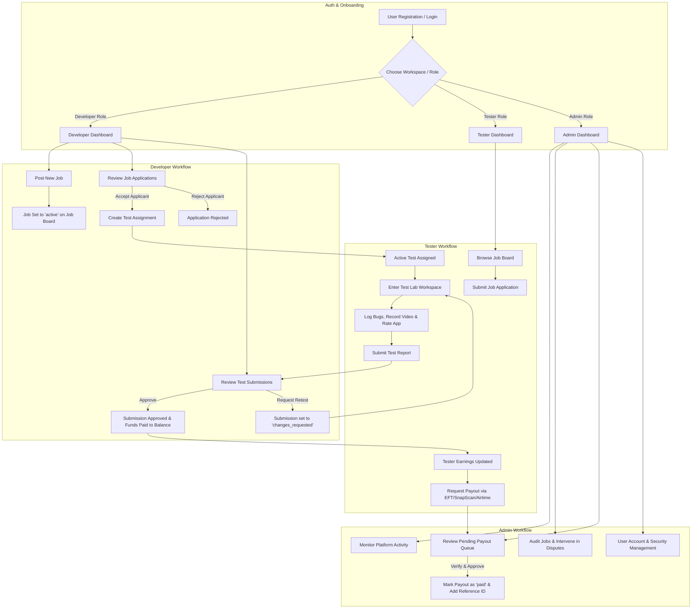

# SQUASH Platform: System Architecture & Dashboard Workflow Documentation

## 1. System Overview & Architecture

### 1.1 Core Platform Purpose
**SQUASH** is a crowdsourced QA, usability testing, and bug hunting marketplace designed to connect product developers with verified real-world testers across South Africa and globally. The platform enables developers to post digital products (Mobile Apps, Web Platforms, Desktop Software) for testing, receive structured feedback and high-severity bug reports with video/screen recordings, and reward testers upon report approval.

### 1.2 Technology Stack
* **Frontend**: React 18, TypeScript, Vite, Tailwind CSS, Lucide Icons, React Router v6.
* **Backend & Database**: Supabase (PostgreSQL 15), Row Level Security (RLS) policies, Edge Functions.
* **Authentication**: Supabase Auth supporting Email/Password, OAuth (Google, GitHub), and multi-role profile management.
* **Financial Model**: All financial amounts are stored as integer values in ZAR (South African Rand) to eliminate floating-point rounding errors. Supports South African payout methods (EFT, SnapScan, Airtime).

### 1.3 Role & Access Control Model
The system enforces strict multi-role access control defined in [auth.tsx](file:///c:/Users/Admin/Documents/Personal%20Documents/SQUASH/src/auth.tsx) and [schema.sql](file:///c:/Users/Admin/Documents/Personal%20Documents/SQUASH/supabase/schema.sql).
* **`developer`**: Can post jobs, review tester applications, inspect submitted bug reports, request retests, approve submissions, and manage billing.
* **`tester`**: Can browse job listings, submit job applications, execute tests in the Test Lab, log bug reports with media evidence, track earnings, and request payouts.
* **`admin`**: Full administrative access to oversee platform health, moderate jobs and submissions, manage user status/balances, process payouts, and enforce security/policy guidelines.

---

## 2. End-to-End System Workflow Architecture



---

## 3. Developer Dashboard Perspective & Workflows

### 3.1 Overview
The **Developer Dashboard** serves as the command center for product managers, software engineers, and founders to launch test runs, track applicant quality, inspect incoming bug reports, and manage QA budgets.

### 3.2 Key Pages & Navigation
* **Overview Dashboard** (`/dashboard`): [SquashDeveloperDashboard.tsx](file:///c:/Users/Admin/Documents/Personal%20Documents/SQUASH/src/SquashDeveloperDashboard.tsx)
  * Displays total active jobs, applicant counts, completed test reports, bug counts by severity, and quick action shortcuts.
* **Post a Job** (`/post-job`): [SquashPostJobPage.tsx](file:///c:/Users/Admin/Documents/Personal%20Documents/SQUASH/src/SquashPostJobPage.tsx)
  * Multi-step job posting wizard with package selection (Starter, Growth, Pro, Enterprise).
* **My Jobs** (`/developer/jobs`): [SquashDeveloperViewsPage.tsx](file:///c:/Users/Admin/Documents/Personal%20Documents/SQUASH/src/SquashDeveloperViewsPage.tsx)
  * List of all created jobs categorized by status (`draft`, `active`, `in_review`, `completed`, `cancelled`).
* **Applicant Review** (`/developer/applications`): [SquashDeveloperViewsPage.tsx](file:///c:/Users/Admin/Documents/Personal%20Documents/SQUASH/src/SquashDeveloperViewsPage.tsx)
  * Review tester profiles, approval rates, ratings, and cover notes before assigning jobs.
* **Submissions Review** (`/developer/submissions`): [SquashDeveloperViewsPage.tsx](file:///c:/Users/Admin/Documents/Personal%20Documents/SQUASH/src/SquashDeveloperViewsPage.tsx)
  * Detailed quality control hub for approving submissions or requesting retests.
* **Reports Directory** (`/developer/reports`): [SquashDeveloperViewsPage.tsx](file:///c:/Users/Admin/Documents/Personal%20Documents/SQUASH/src/SquashDeveloperViewsPage.tsx)
  * Aggregated bug reports with severity breakdown (Low, Medium, High, Critical) and media downloads.
* **Billing & Payments** (`/billing`): [SquashDeveloperBillingPage.tsx](file:///c:/Users/Admin/Documents/Personal%20Documents/SQUASH/src/SquashDeveloperBillingPage.tsx)
  * Escrow management, deposit history, invoice logs, and payment method options.

### 3.3 Detailed Developer Workflows

#### Workflow D1: Posting a New Testing Job
1. Navigate to `/post-job`.
2. Select a Tier Package:
   * **Starter**: 3 Testers, basic bug logging.
   * **Growth**: 5 Testers, detailed test coverage.
   * **Pro**: 10 Testers, video proof & custom focus areas.
   * **Enterprise**: Custom volume & dedicated support.
3. Input Application Metadata: Title, App URL, Logo URL, Target Platform (iOS, Android, Web, Desktop), and Category.
4. Define Test Requirements: Instructions, specific tasks to execute, focus areas (e.g., checkout flow, UI responsiveness, edge cases), and required tester specializations (e.g., Mobile QA, Fintech, Accessibility).
5. Optional Live Session: Enable live testing session scheduling.
6. Submit form -> Triggers `createDeveloperJob()` in [jobApi.ts](file:///c:/Users/Admin/Documents/Personal%20Documents/SQUASH/src/lib/jobApi.ts). Job status is set to `active` and listed on the Tester Job Board.

#### Workflow D2: Reviewing Applicants & Assigning Testers
1. Navigate to `/developer/applications`.
2. Filter applications by Job Title or Status (`pending`, `accepted`, `rejected`).
3. Inspect applicant profile card showing: Bio, Rating (0-5 stars), Approval Rate (%), Tests Completed, and cover note.
4. Click **Accept**:
   * Application status updates to `accepted`.
   * Creates a record in `test_assignments` with status `active`.
   * Sends an automated notification to the tester via [notificationApi.ts](file:///c:/Users/Admin/Documents/Personal%20Documents/SQUASH/src/lib/notificationApi.ts).
5. Click **Reject**: Application status updates to `rejected`.

#### Workflow D3: Quality Control & Report Approval
1. Navigate to `/developer/submissions` or `/report-details`.
2. Review report metrics: Usability score, performance score, onboarding score, device compatibility, bug severity score, and summary.
3. Inspect attached Bug Reports: Title, severity rating, steps to reproduce, expected vs. actual results, screenshots, and screen recordings (up to 60s).
4. Take Action:
   * **Approve Submission**:
     * Submission status updates to `approved`.
     * Assignment status updates to `approved`.
     * Tester's `available_balance_zar` increases by the allocated payout amount.
     * Tester approval rate and total tests completed statistics update automatically.
   * **Request Retest**:
     * Open [RetestRequestModal.tsx](file:///c:/Users/Admin/Documents/Personal%20Documents/SQUASH/src/components/RetestRequestModal.tsx).
     * Provide explicit instructions on missing evidence or unclear steps.
     * Submission status updates to `changes_requested`.
     * Tester receives notification to re-open the Test Lab and submit updated evidence.

---

## 4. Tester Dashboard Perspective & Workflows

### 4.1 Overview
The **Tester Dashboard** is designed for freelance QA testers and bug hunters to discover paid testing opportunities, execute tests with built-in screen/video recording tools, submit bug reports, track reputation tiers, and withdraw earned ZAR.

### 4.2 Key Pages & Navigation
* **Tester Main Dashboard** (`/tester/dashboard`): [SquashTesterDashboardPage.tsx](file:///c:/Users/Admin/Documents/Personal%20Documents/SQUASH/src/SquashTesterDashboardPage.tsx)
  * High-level summary of active tests, pending reviews, earned balance, recent notifications, and recommended jobs.
* **Job Board** (`/job-board` / `/tester-jobs`): [SquashTesterJobBoard.tsx](file:///c:/Users/Admin/Documents/Personal%20Documents/SQUASH/src/SquashTesterJobBoard.tsx)
  * Searchable job feed with filters for platform, payout amount, category, and required specializations.
* **My Active Tests** (`/tester/my-tests`): [SquashTesterMyTestsPage.tsx](file:///c:/Users/Admin/Documents/Personal%20Documents/SQUASH/src/SquashTesterMyTestsPage.tsx)
  * List of accepted test assignments currently in progress with due dates.
* **Test Lab Workspace** (`/test-lab`): [SquashActiveTestScreen.tsx](file:///c:/Users/Admin/Documents/Personal%20Documents/SQUASH/src/SquashActiveTestScreen.tsx)
  * Live testing studio featuring recording timers, task checklists, bug report forms, attachment uploaders, and score sliders.
* **My Reports** (`/tester/reports`): [SquashTesterReportsPage.tsx](file:///c:/Users/Admin/Documents/Personal%20Documents/SQUASH/src/SquashTesterReportsPage.tsx)
  * Submission history showing status (`submitted`, `approved`, `changes_requested`, `rejected`) and developer feedback.
* **Earnings & Payouts** (`/tester/earnings`): [SquashTesterEarningsPage.tsx](file:///c:/Users/Admin/Documents/Personal%20Documents/SQUASH/src/SquashTesterEarningsPage.tsx)
  * Financial overview showing total earned, pending clearance, available balance, transaction history, and payout requests.
* **Payout Method Setup** (`/tester/payout-method`): [SquashTesterPayoutMethodPage.tsx](file:///c:/Users/Admin/Documents/Personal%20Documents/SQUASH/src/SquashTesterPayoutMethodPage.tsx)
  * Configure South African payout details: EFT (Bank account), SnapScan (QR/Phone), or Airtime (Mobile Carrier).
* **Tester Profile & Specializations** (`/tester/profile`): [SquashTesterProfilePage.tsx](file:///c:/Users/Admin/Documents/Personal%20Documents/SQUASH/src/SquashTesterProfilePage.tsx)
  * Update bio, profile visibility, and specialization badges (e.g., Security, Mobile, Payment Gateways).
* **Gamification Hub** (`/tester/leaderboard`, `/tester/level-benefits`, `/tester/referrals`):
  * Level progression (Novice -> Bronze -> Silver -> Gold -> Elite Bug Hunter), leaderboards, and referral bonuses.

### 4.3 Detailed Tester Workflows

#### Workflow T1: Browsing Jobs & Applying
1. Navigate to `/job-board`.
2. Filter jobs by Platform (iOS, Android, Web), Category (Fintech, E-commerce, Gaming, Social), or Payout.
3. Open Job Details modal to inspect tasks, focus areas, and required specializations.
4. Click **Apply for Job**:
   * Add a custom application note highlighting relevant experience or test devices.
   * Calls `applyForJob()` in [jobApi.ts](file:///c:/Users/Admin/Documents/Personal%20Documents/SQUASH/src/lib/jobApi.ts).
   * Creates a `job_applications` record with status `pending`.

#### Workflow T2: Executing Tests in the Test Lab Workspace
1. Once accepted by the developer, navigate to `/tester/my-tests` and click **Open Test Lab**.
2. Arrive at `/test-lab` ([SquashActiveTestScreen.tsx](file:///c:/Users/Admin/Documents/Personal%20Documents/SQUASH/src/SquashActiveTestScreen.tsx)):
   * **Live Timer & Recorder Bar**: Start live timer, track session duration (up to 60 seconds for video clips).
   * **Task Checklist**: Mark off individual developer tasks as completed.
   * **Log Bug Report Modal**:
     * Title & Detailed Description.
     * Severity: Low, Medium, High, Critical.
     * Steps to Reproduce (numbered list).
     * Expected vs. Actual Results.
     * Attach Screenshot or Video File.
   * **Evaluation Rubric**: Rate the application across 5 parameters (Usability, Performance, Onboarding, Bug Severity, Device Compatibility).
   * **Submit Summary**: Provide qualitative feedback summary.
3. Click **Submit Test Report**:
   * Creates `test_submissions` record (status `submitted`).
   * Saves all associated `bug_reports`.
   * Updates `test_assignments` status to `submitted`.
   * Triggers developer notification.

#### Workflow T3: Addressing Retest Requests
1. Receive notification: "Developer requested changes on your submission".
2. Navigate to `/tester/reports` and view feedback note.
3. Click **Update Submission** to re-enter `/test-lab`.
4. Add missing screenshots/video evidence or clarify reproduction steps.
5. Resubmit report -> Submission status returns to `submitted` for developer re-evaluation.

#### Workflow T4: Requesting Payouts
1. Earn funds from approved test submissions (accumulated in `available_balance_zar`).
2. Navigate to `/tester/earnings` or `/tester/payout-method`.
3. Ensure preferred payout method is configured:
   * **EFT**: Bank Name, Account Number, Branch Code, Account Type.
   * **SnapScan**: Registered Mobile Number / QR code.
   * **Airtime**: Mobile Network Operator (Vodacom, MTN, Cell C, Telkom) & Phone Number.
4. Click **Request Payout**:
   * Enter desired ZAR amount (must be $\le$ `available_balance_zar`).
   * Submission creates a `payouts` record with status `pending`.
   * Funds are held pending administrative verification.

---

## 5. Admin Dashboard Perspective & Workflows

### 5.1 Overview
The **Admin Dashboard** provides full operational control over the SQUASH ecosystem. Platform administrators monitor systemic metrics, moderate marketplace jobs, inspect report quality, resolve developer-tester disputes, enforce security policies, and disburse financial payouts.

### 5.2 Key Pages & Navigation
* **Admin Overview** (`/admin`): [SquashAdminDashboardPage.tsx](file:///c:/Users/Admin/Documents/Personal%20Documents/SQUASH/src/SquashAdminDashboardPage.tsx)
  * System health metrics: Total Users, Developer/Tester split, Active Jobs, Submitted Reports, Pending Payouts Volume in ZAR, and activity logs.
* **Payouts Management** (`/admin/payouts`): [SquashAdminPayoutsPage.tsx](file:///c:/Users/Admin/Documents/Personal%20Documents/SQUASH/src/SquashAdminPayoutsPage.tsx)
  * Financial disbursement queue for auditing and approving tester payout requests.
* **User Management** (`/admin/users` & `/admin/users/:userId`): [SquashAdminUsersPage.tsx](file:///c:/Users/Admin/Documents/Personal%20Documents/SQUASH/src/SquashAdminUsersPage.tsx), [SquashAdminUserProfilePage.tsx](file:///c:/Users/Admin/Documents/Personal%20Documents/SQUASH/src/SquashAdminUserProfilePage.tsx)
  * Account management directory to inspect user details, adjust role assignments, suspend accounts, and view notifications.
* **Jobs Management** (`/admin/jobs` & `/admin/jobs/:jobId`): [SquashAdminJobsPage.tsx](file:///c:/Users/Admin/Documents/Personal%20Documents/SQUASH/src/SquashAdminJobsPage.tsx), [SquashAdminJobDetailPage.tsx](file:///c:/Users/Admin/Documents/Personal%20Documents/SQUASH/src/SquashAdminJobDetailPage.tsx)
  * Complete registry of all platform jobs with options to edit status, review budget allocations, or remove non-compliant listings.
* **Reports Oversight** (`/admin/reports`): [SquashAdminReportsPage.tsx](file:///c:/Users/Admin/Documents/Personal%20Documents/SQUASH/src/SquashAdminReportsPage.tsx)
  * Oversight of all test submissions and bug reports across the platform for quality control and dispute intervention.
* **Security & Governance** (`/admin/security`): [SquashAdminSecurityPage.tsx](file:///c:/Users/Admin/Documents/Personal%20Documents/SQUASH/src/SquashAdminSecurityPage.tsx)
  * Platform audit logs, policy governance (POPIA, Terms of Service, Payout Policy), and admin security configuration.

### 5.3 Detailed Admin Workflows

#### Workflow A1: Financial Disbursement & Payout Approval
1. Navigate to `/admin/payouts`.
2. Inspect pending payout queue loaded via `getAdminPayouts()` in [adminApi.ts](file:///c:/Users/Admin/Documents/Personal%20Documents/SQUASH/src/lib/adminApi.ts).
3. Review Payout Record: Tester name, email, ZAR amount requested, payout method type (EFT, SnapScan, Airtime), masked payment details, and request timestamp.
4. Execute Disbursement Action:
   * **Approve & Pay**:
     * Click **Mark as Paid**.
     * Enter bank transfer/payment reference ID (e.g., `EFT-20260724-8849`).
     * Option to add administrative notes.
     * Payout status transitions to `paid`. `processed_at` timestamp recorded.
     * System deducts amount from tester's balance and sends payout confirmation notification.
   * **Reject / Hold**:
     * Click **Reject**. Input rejection reason (e.g., invalid account number).
     * Payout status transitions to `failed` or `cancelled`.
     * Funds returned to tester's available balance with notification.

#### Workflow A2: Dispute Resolution & Submission Intervention
1. Navigate to `/admin/reports` or `/admin/jobs/:jobId`.
2. Locate disputed submission (e.g., tester claims valid bug, developer rejected or requested unfair retest).
3. Admin inspects raw evidence: Steps to reproduce, uploaded screenshots, and 60-second video clips.
4. Administrative Actions:
   * Override submission status to `approved` (forces payout to tester from escrow).
   * Override submission status to `rejected` (refunds developer escrow allocation).
   * Log administrative audit action in `admin_activity_log`.

#### Workflow A3: User & Platform Governance
1. Navigate to `/admin/users`.
2. Search by name, email, or role filter (`developer`, `tester`, `admin`).
3. Click user row to enter `/admin/users/:userId`.
4. Inspect complete telemetry: Account creation date, jobs posted, reports submitted, rating history, and financial transactions.
5. Modify User State:
   * Change status: `active`, `under_review`, `suspended`.
   * Add/Remove user roles.
   * Send custom push notification directly to user.

---

## 6. Database Entity Relationship & State Transitions

### 6.1 Core Data Schema Entities
Defined in [schema.sql](file:///c:/Users/Admin/Documents/Personal%20Documents/SQUASH/supabase/schema.sql):

| Table Name | Primary Purpose | Key Foreign Keys |
| :--- | :--- | :--- |
| `profiles` | User core account information | `id` -> `auth.users(id)` |
| `developer_profiles` | Developer company & billing profile | `user_id` -> `profiles(id)` |
| `tester_profiles` | Tester metrics, balance & ratings | `user_id` -> `profiles(id)` |
| `tester_specializations` | Expertise tags for testers | `tester_id` -> `tester_profiles(user_id)` |
| `jobs` | Testing job listings and requirements | `developer_id` -> `developer_profiles(user_id)` |
| `job_applications` | Tester applications for jobs | `job_id` -> `jobs(id)`, `tester_id` -> `tester_profiles` |
| `test_assignments` | Active test allocations | `job_id` -> `jobs(id)`, `tester_id` -> `tester_profiles` |
| `test_submissions` | Completed test evaluation reports | `assignment_id` -> `test_assignments`, `tester_id`, `job_id` |
| `bug_reports` | Individual bugs logged with evidence | `submission_id`, `assignment_id`, `tester_id`, `job_id` |
| `payout_methods` | Bank/SnapScan/Airtime account details | `tester_id` -> `tester_profiles` |
| `payouts` | Withdrawal financial records | `tester_id`, `payout_method_id` |
| `notifications` | System in-app notifications | `user_id` -> `profiles(id)` |

### 6.2 Entity Lifecycle State Transitions Matrix

#### Job Status Lifecycle (`job_status`)
```
[draft] ---> [active] ---> [in_review] ---> [completed]
               |
               +---> [cancelled]
```
* `draft`: Job created but not yet published.
* `active`: Listed on Job Board; accepting applications.
* `in_review`: Testers assigned and executing tests.
* `completed`: All tester reports approved and finalized.
* `cancelled`: Cancelled by developer or admin; escrow refunded.

#### Application Status Lifecycle (`application_status`)
```
[pending] ---> [accepted] (Triggers creation of test_assignment)
    |
    +---------> [rejected]
    |
    +---------> [withdrawn]
```

#### Submission Status Lifecycle (`submission_status`)
```
[draft] ---> [submitted] ---> [approved] (Triggers payout to tester balance)
                 |
                 +---------> [changes_requested] ---> (Tester resubmits back to [submitted])
                 |
                 +---------> [rejected]
```

#### Payout Status Lifecycle (`payout_status`)
```
[pending] ---> [processing] ---> [paid] (Completed with reference ID)
    |
    +--------------------------> [failed] (Balance restored)
    |
    +--------------------------> [cancelled]
```

---

## 7. Security, Compliance & Data Protection Matrix

### 7.1 Row Level Security (RLS) Policy Summary
* **Profiles**: Users can read/update their own profile. Admins can read/update all profiles. Developers can view profiles of testers who applied to their jobs.
* **Jobs**: Anyone authenticated can view `active` jobs. Developers can edit only their own jobs. Admins have unrestricted access.
* **Test Submissions & Bug Reports**: Accessible only by the assigned tester, the job developer owner, and admins.
* **Payout Details**: Payout methods and transaction histories are isolated strictly to the individual tester owner and admins.

### 7.2 POPIA & South African Data Privacy Compliance
* All financial transactions follow South African POPIA (Protection of Personal Information Act) regulations.
* Payout details (Bank account numbers, phone numbers) are masked in UI views (`masked_details`) and visible unmasked only to authorized admin roles during disbursement processing.

---

## 8. Summary of File References

| File Name | Description | Path |
| :--- | :--- | :--- |
| `App.tsx` | Main Router & Role Guards | [App.tsx](file:///c:/Users/Admin/Documents/Personal%20Documents/SQUASH/src/App.tsx) |
| `auth.tsx` | Auth Context & Role Session Logic | [auth.tsx](file:///c:/Users/Admin/Documents/Personal%20Documents/SQUASH/src/auth.tsx) |
| `schema.sql` | Supabase Database Schema & RLS | [schema.sql](file:///c:/Users/Admin/Documents/Personal%20Documents/SQUASH/supabase/schema.sql) |
| `jobApi.ts` | Job & Submission Data Services | [jobApi.ts](file:///c:/Users/Admin/Documents/Personal%20Documents/SQUASH/src/lib/jobApi.ts) |
| `adminApi.ts` | Administrative Data Services | [adminApi.ts](file:///c:/Users/Admin/Documents/Personal%20Documents/SQUASH/src/lib/adminApi.ts) |
| `SquashDeveloperDashboard.tsx` | Developer Overview Hub | [SquashDeveloperDashboard.tsx](file:///c:/Users/Admin/Documents/Personal%20Documents/SQUASH/src/SquashDeveloperDashboard.tsx) |
| `SquashPostJobPage.tsx` | Job Creation & Wizard | [SquashPostJobPage.tsx](file:///c:/Users/Admin/Documents/Personal%20Documents/SQUASH/src/SquashPostJobPage.tsx) |
| `SquashTesterDashboardPage.tsx` | Tester Overview Hub | [SquashTesterDashboardPage.tsx](file:///c:/Users/Admin/Documents/Personal%20Documents/SQUASH/src/SquashTesterDashboardPage.tsx) |
| `SquashTesterJobBoard.tsx` | Job Search & Applications | [SquashTesterJobBoard.tsx](file:///c:/Users/Admin/Documents/Personal%20Documents/SQUASH/src/SquashTesterJobBoard.tsx) |
| `SquashActiveTestScreen.tsx` | Test Lab Execution Studio | [SquashActiveTestScreen.tsx](file:///c:/Users/Admin/Documents/Personal%20Documents/SQUASH/src/SquashActiveTestScreen.tsx) |
| `SquashAdminDashboardPage.tsx` | Admin Control Panel | [SquashAdminDashboardPage.tsx](file:///c:/Users/Admin/Documents/Personal%20Documents/SQUASH/src/SquashAdminDashboardPage.tsx) |
| `SquashAdminPayoutsPage.tsx` | Financial Disbursement Queue | [SquashAdminPayoutsPage.tsx](file:///c:/Users/Admin/Documents/Personal%20Documents/SQUASH/src/SquashAdminPayoutsPage.tsx) |
